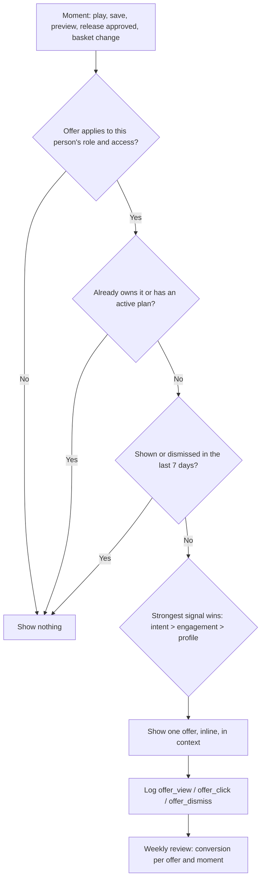

# Personalised offers: the right offer, to the right person, at the right time

Plan only (not built). Goal: show each BVS offer to the people most likely to want it, at a natural moment, using signals BVS already has — and never interrupt listening or feel pushy.

## Signals BVS already records

| Signal | Where it lives today | What it tells us |
| --- | --- | --- |
| Role and access (listener, artist, producer, writer, show) | `profiles`, app session `access` | Which offers apply at all |
| Releases and their review status | `/api/creator/workspace` | Artist has an approved release that could go wider |
| Plays, saves, follows | `analytics_events`, Library sync | Taste, favourite artists, engagement level |
| Beat previews and licence views | `player_start` on beats, `beat_licence_view` | Producer/artist intent to buy a beat |
| Purchases and basket value | commerce ledger, checkout events | Buyer history, price comfort |
| Premium status | `premiumActive` in app session | Already subscribed: don't upsell Premium |
| Chart badges | `creator_achievements` | Momentum moments worth celebrating |

## Offers and when to show them

| Offer | Who | Trigger moment | Where | Never show when |
| --- | --- | --- | --- | --- |
| Buy a song ($2) | Listeners | 3rd play of the same song, or after saving it | Song page, Now Playing, Library row | Song isn't for sale; already bought |
| "Complete the bundle" (basket to $5) | Buyers | One song in basket | Checkout (already live) | Basket already over target |
| Beat licence | Artists, producers | 2+ previews of the same beat, or a licence view without purchase | Beat page, BeatStore card | Already licensed that beat |
| Premium Instant ($5.99/release) | Artists | A release is approved and live on BVS | Studio overview "Next" card, release page | Annual active; release already eligible |
| Artist Premium Annual ($29/yr) | Artists | 3rd approved release this year (Annual cheaper from the 5th) | Studio, Premium page | Annual active |
| Creator services (mix/master) | Artists | Draft or submission waiting; editorial asked for audio changes | Studio inbox, release page | No release in progress |
| Follow / notifications | Listeners | 3+ plays of one artist | Artist page, Now Playing | Already following |
| Sign up | Signed-out listeners | 5th song or first save attempt | Gentle sheet, once per session | Already dismissed this week |

## Decision flow

## Rules of thumb

- One offer per screen, never during playback start, never as a full-screen popup.
- Free listening always stays free; offers sit next to the content, not over it.
- Respect dismissals for 7 days; respect Data Saver and quiet hours for notifications.
- Payment never buys editorial approval, rotation or chart positions (keep stating this on Premium).

## Build steps (when ready)

1. `offer-eligibility.ts`: a pure function `(profile, signals, now) → offer | null` with tests, like `beat-hashtags.ts`.
2. One `/api/offers/next?context=song|beat|studio|checkout` endpoint that reads existing tables only.
3. A shared `<OfferSlot context=… />` component placed on song, beat, Studio and checkout pages.
4. `OfferAnalytics` is already in place for view/click tracking; add `offer_dismiss`.
5. Start with two offers (song purchase after 3rd play, Premium Instant after release approval), measure for two weeks, then add the rest.
